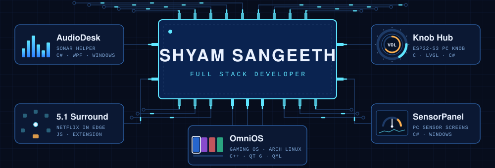

# Hi, I'm Shyam Sangeeth 👋

**Full Stack Developer** · 4+ years building production web applications with NodeJS, TypeScript, ReactJS and Python.

## 🚀 Projects

**[AudioDesk](https://github.com/Shyam-Sangeeth/AudioDesk)** · *C#, WPF, Windows* 
A helper for SteelSeries Sonar. For each channel (Game, Media, Aux) you choose whether apps go through Sonar for its EQ and effects, or bypass it and play lossless on your real device at its full sample rate, bit depth and channel count. It also adds profiles, presets per device and more control over Sonar.

**[Knob Hub](https://github.com/Shyam-Sangeeth/KnobHub)** · *C (LVGL), C#, ESP32-S3* 
A turnable, touchable PC controller built on the Elecrow CrowPanel 1.28" round knob display. Its firmware, Knob OS, only draws screens; the apps run on the PC as Knob Hub plugins, so a new app needs no firmware update. Apps so far: AudioDesk, Media and Counter.

**[Knob Hub Apps](https://github.com/Shyam-Sangeeth/KnobHub-Apps)** · *C#, Knob Hub plugins* 
Apps for Knob Hub, currently AudioDesk and Counter. Each one runs on the PC inside Knob Hub and shows its screens on the knob. They're released as `.knobapp` files that Knob Hub's **Add apps** window installs and updates.

**[SensorPanel](https://github.com/Shyam-Sangeeth/SensorPanel)** · *C#, Windows* 
Live hardware sensor panels for small screens: CPU, GPU, memory, drive, fan and framerate readings on a 3.5" USB display or an HDMI screen, with an editor to design the panel.

**[OmniOS](https://github.com/Shyam-Sangeeth/OmniOS)** · *C++20, Qt 6 / QML, Arch Linux* · 🚧 in progress 
A gaming operating system built on Arch Linux. It boots from USB into a KDE Plasma desktop with a controller-friendly **Game Mode**, a PS5-style tile launcher that builds your library from `~/Games` and Steam. It runs Linux games natively, Windows games through Steam and Proton, and console games through emulators. It includes its own installer, and the ISO builds in Docker and is tested in QEMU.

**[Netflix 5.1 Surround for Edge](https://github.com/Shyam-Sangeeth/Edge_5.1_Audio_Netflix)** · *JavaScript, browser extension* 
A Microsoft Edge extension that unlocks 5.1 surround audio on Netflix, which normally plays in stereo on desktop, in both the Edge browser and the Windows Netflix app.

## 🛠️ Tech Stack

|  |  |
|---|---|
| **Languages** | JavaScript, TypeScript, Python, C#, C++, Java, C |
| **Frameworks & Libraries** | Node.js, Express, React, Ant Design, Flask, Bootstrap, Jest, SQLAlchemy, Sequelize |
| **Databases** | MySQL, MongoDB |
| **DevOps** | Docker, Kubernetes, Jenkins, Git, CI/CD |

## 🌱 Outside Work

- 👀 Interested in PC audio, IoT, game development and OS development
- 🎮 Currently building AudioDesk, Knob Hub and OmniOS
